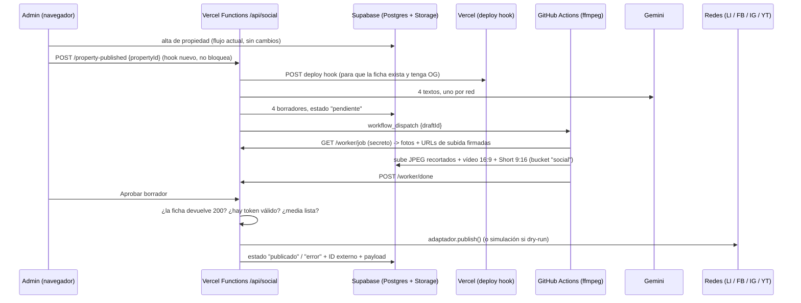

# Publicación automática en redes sociales — Plan técnico

> Estado: **borrador para aprobación** (Fase 1). Nada de esto está implementado ni aplicado.
> Fecha de verificación de la documentación oficial: 26-10-2026.
> Lo marcado **[sin verificar]** no se ha podido confirmar en la documentación oficial y se comprobará antes de usarlo.

## 0. Decisiones ya tomadas

| Tema | Decisión |
|------|----------|
| Backend | Vercel Functions (`/api/*.js` en este mismo repo). Sin servidor aparte. |
| Enlace roto en propiedades nuevas | Al crear la propiedad se dispara un **deploy hook de Vercel**. No se puede aprobar un borrador hasta que la URL de la ficha devuelve 200. |
| Idioma de los posts | Español. |
| Modo por defecto | `SOCIAL_DRY_RUN=true`. Solo el valor literal `false` publica de verdad. |
| Dependencias nuevas | **Ninguna.** Se usan `fetch`, `node:crypto`, `node:test` y `@supabase/supabase-js` (ya instalado). ffmpeg se ejecuta en GitHub Actions, no en el proyecto. |

## a) Arquitectura

### Flujo completo



### Piezas

| Pieza | Ubicación propuesta | Qué hace |
|-------|--------------------|----------|
| **Evento "propiedad publicada"** | `src/utils/socialEvents.js` (nuevo), llamado al final de `handleSaveProperty` en [AdminDashboard.jsx](../../src/pages/AdminDashboard.jsx) solo cuando `!editingId` y las fotos ya se han subido | Envía `POST /api/social/property-published` con el JWT de la sesión de Supabase. Se ejecuta sin esperar respuesta: si falla, se registra en consola y el alta sigue igual. **Es el único cambio en el flujo actual.** |
| **Cola de borradores** | Tabla `social_posts` | Una fila por red y propiedad (`unique(property_id, network)`), así que el evento es idempotente. |
| **Generación de textos** | `server/social/copy.js` | Llama a Gemini por REST (sin SDK) con un prompt por red. Valida longitud y hashtags; si no cumple, recorta o reintenta una vez. |
| **Media** | GitHub Actions + bucket `social` | ffmpeg genera los JPEG por red, el vídeo y el Short. Ver apartado c. |
| **Aprobación** | Pantalla "Redes sociales" en `/admin` | Listar, editar, aprobar, rechazar, reintentar y ver el estado. |
| **Adaptadores** | `server/social/adapters/{linkedin,facebook,instagram,youtube}.js` | Implementan la interfaz común de abajo. |
| **Tokens** | Tabla `social_accounts` + `server/social/crypto.js` | Cifrado AES-256-GCM con `node:crypto`. La clave está solo en el entorno de Vercel. |
| **Renovación y limpieza** | Cron diario de Vercel → `/api/social/cron` | Renueva tokens, avisa de caducidades y borra la media ya publicada. En Hobby, el cron solo puede ejecutarse una vez al día ([verificado](https://vercel.com/docs/cron-jobs/usage-and-pricing)). |

### Interfaz común de adaptador

```js
/**
 * @typedef {Object} SocialDraft
 * @property {string} network        'linkedin' | 'facebook' | 'instagram' | 'youtube'
 * @property {string} text           cuerpo del post (o descripción en YouTube)
 * @property {string} [title]        solo YouTube
 * @property {string[]} hashtags
 * @property {string} link           URL canónica de la ficha
 * @property {{url:string, alt:string}[]} images   ya preparadas para esta red
 * @property {{video_url?:string, short_url?:string}} [video]
 *
 * @typedef {Object} SocialAdapter
 * @property {string} network
 * @property {{maxChars:number, maxHashtags:number, minImages:number, maxImages:number}} limits
 * @property {(draft:SocialDraft) => string[]} validate          lista de errores ([] = válido)
 * @property {(draft:SocialDraft, account) => object} buildPayload  lo que se enviaría, sin secretos
 * @property {(draft:SocialDraft, account, ctx:{dryRun:boolean, fetch:typeof fetch}) =>
 *            Promise<{externalId:string|null, externalUrl:string|null, payload:object}>} publish
 * @property {(account) => Promise<object>} [refresh]  renueva el token si la red lo permite
 */
```

- `fetch` se inyecta: en los tests se sustituye por un mock y nunca hay red.
- En dry-run, `publish` devuelve `buildPayload()` sin llamar a la red social. El borrador queda como `publicado` con `dry_run=true`.
- Para añadir una red (Pinterest, TikTok…) basta con un archivo nuevo en `adapters/` y una entrada en el registro `adapters/index.js`.

### Estados

```
generando ─▶ pendiente ─▶ aprobado ─▶ publicando ─▶ publicado
                │                         │
                ▼                         ▼
            rechazado                   error ──(reintentar)──▶ publicando
```

| Estado | Significado |
|--------|-------------|
| `generando` | Textos o media en preparación |
| `pendiente` | Listo para revisión |
| `aprobado` | Aprobado, a la espera de publicarse (por ejemplo, si el deploy aún no ha terminado) |
| `publicando` | Llamada en curso (bloquea el doble clic) |
| `publicado` | Con `external_id` y `external_url`. Si `dry_run=true`, se muestra como «publicado (dry-run)» |
| `error` | Con `last_error`. Botón «Reintentar» |
| `rechazado` | Descartado por el admin |

### Reintentos

- **Dentro de una publicación:** hasta 3 intentos con espera exponencial (1 s, 4 s, 16 s), solo ante 429, 5xx y errores de red. Los 4xx no se reintentan.
- **Manual:** desde el panel, sin límite, quedando cada intento registrado en `social_post_attempts`.
- **Idempotencia:** si ya existe `external_id`, «Reintentar» no vuelve a publicar. En Instagram se reutiliza el contenedor ya creado si sigue siendo válido.

### Comprobaciones antes de publicar (al aprobar)

1. La URL de la ficha devuelve **200** (el deploy ha terminado). Si no, el borrador queda en `aprobado` y la pantalla muestra «Esperando despliegue».
2. La cuenta de la red está conectada y su token no ha caducado.
3. La media del borrador está lista (`media_status = listo`).
4. `validate()` no devuelve errores.

### Caducidad de tokens por red

| Red | Token | Duración | Renovación |
|-----|-------|----------|-----------|
| Facebook e Instagram | Token de usuario de larga duración | ~60 días ([verificado](https://developers.facebook.com/docs/facebook-login/guides/access-tokens/get-long-lived)) | Solo se usa para obtener el token de página |
| Facebook e Instagram | **Token de página** (obtenido con el de usuario de larga duración) | **Sin fecha de caducidad**, pero se invalida si cambia la contraseña, se pierde el rol en la página o se desautoriza la app ([verificado](https://developers.facebook.com/docs/facebook-login/guides/access-tokens/get-long-lived)) | El cron lo comprueba a diario. Si falla, aviso en el panel y Paco vuelve a pulsar «Conectar» |
| LinkedIn | Token de acceso | 60 días ([verificado](https://learn.microsoft.com/en-us/linkedin/shared/authentication/programmatic-refresh-tokens)) | Con *refresh token* (365 días fijos) **solo si la app está aprobada en el Marketing Developer Platform** [sin verificar que el tier Standard de Community Management lo incluya]. Si no, hay que reconectar cada 60 días, con aviso 10 días antes |
| YouTube | Token de acceso | 1 hora | Se renueva en cada publicación con el *refresh token* |
| YouTube | Refresh token | **7 días si la app de Google está en modo «Testing»** ([verificado](https://developers.google.com/identity/protocols/oauth2)). Sin caducidad fija en «Production», salvo 6 meses sin uso o revocación | **Hay que pasar la app a Production** (ver ALTA_CUENTAS.md) |

### Seguridad

- Tokens cifrados (AES-256-GCM, IV aleatorio por valor) en `social_accounts`. Esa tabla tiene RLS activado **y ninguna política**, así que solo la clave `service_role` puede leerla.
- La clave `service_role` y la de cifrado viven solo en las variables de entorno de Vercel. Nunca llevan el prefijo `VITE_`, porque todo lo que lo lleva acaba en el bundle público.
- Cada endpoint de `/api/social/*` exige el JWT de Supabase del admin y comprueba que el email está en `ADMIN_EMAILS`.
- OAuth: el parámetro `state` va firmado con HMAC y caduca en 10 minutos. **Paco inicia sesión él mismo en cada red**; el código nunca ve ni guarda contraseñas.
- El worker de GitHub no tiene credenciales de Supabase. Pide el trabajo a `/api/social/worker/*` con el secreto `VIDEO_WORKER_SECRET` (secreto de Actions, que se enmascara en los logs) y recibe URLs de subida firmadas de un solo uso.
- **El repositorio es público** (comprobado con `gh repo view`). Cualquier cosa que se suba a git es pública, incluidos los logs de Actions.
- **Pendiente de Fase 0:** `.env` está versionado. Propongo sacarlo de git (`git rm --cached .env`) y añadirlo a `.gitignore`, dejando un `.env.example`. Requiere tu OK porque elimina el archivo del índice de git.

### Variables de entorno (`.env.example`, solo nombres)

```
# Comportamiento
SOCIAL_DRY_RUN=true
SITE_URL=https://www.azimutproperty.com
ADMIN_EMAILS=

# Servidor (solo en Vercel; nunca con prefijo VITE_)
SUPABASE_URL=
SUPABASE_SERVICE_ROLE_KEY=
SOCIAL_TOKEN_ENC_KEY=            # 32 bytes en base64
OAUTH_STATE_SECRET=
VERCEL_DEPLOY_HOOK_URL=
GEMINI_API_KEY=
GEMINI_MODEL=                    # [sin verificar] se elegirá en la Fase 2 con la doc vigente

# Worker de vídeo
GITHUB_DISPATCH_TOKEN=           # token fine-grained, solo actions:write en este repo
GITHUB_REPO=Paco2000gs/azimut-web
VIDEO_WORKER_SECRET=

# Meta (Facebook + Instagram)
META_APP_ID=
META_APP_SECRET=
META_GRAPH_VERSION=v26.0

# LinkedIn
LINKEDIN_CLIENT_ID=
LINKEDIN_CLIENT_SECRET=
LINKEDIN_API_VERSION=202610
LINKEDIN_ORGANIZATION_ID=        # ID numérico de la página de empresa (no es secreto)

# Google / YouTube
GOOGLE_CLIENT_ID=
GOOGLE_CLIENT_SECRET=
YOUTUBE_PRIVACY=public

# Footer (públicas, en tiempo de build)
VITE_SOCIAL_LINKEDIN_URL=
VITE_SOCIAL_FACEBOOK_URL=
VITE_SOCIAL_INSTAGRAM_URL=
VITE_SOCIAL_YOUTUBE_URL=
```

### Formato de cada red (verificado el 26-10-2026)

| | LinkedIn (página de empresa) | Facebook (página) | Instagram (Business, carrusel) | YouTube |
|---|---|---|---|---|
| **Endpoint** | `POST /rest/posts` con `content.multiImage`, más `POST /rest/images?action=initializeUpload` y un `PUT` por imagen | `POST /{page-id}/photos` con `published=false` por foto, después `POST /{page-id}/feed` con `attached_media[]` | Un contenedor por imagen (`is_carousel_item=true`), después `media_type=CAROUSEL` y luego `POST /{ig-id}/media_publish` | `videos.insert` (subida reanudable), dos veces: vídeo 16:9 y Short 9:16 |
| **Permisos** | `w_organization_social` (rol ADMINISTRATOR o CONTENT_ADMIN en la página) | `pages_manage_posts`, `pages_read_engagement`, `pages_show_list` | `instagram_basic`, `instagram_content_publish`, `pages_read_engagement` (vía Facebook Login, con token de página) | `https://www.googleapis.com/auth/youtube.upload` |
| **Imágenes** | De 2 a 20; JPG, PNG o GIF; menos de 36,1 MP | JPEG, PNG, BMP, GIF o TIFF; **≤ 4 MB** cada una (PNG recomendado < 1 MB). Las fotos sin usar se borran a las ~24 h | De 2 a 20 (el máximo de 20 está verificado); **solo JPEG**, ≤ 8 MB, proporción entre 4:5 y 1,91:1, ancho ≤ 1440 px (si es mayor se reduce). Todas se recortan a la proporción de la primera | — |
| **Texto** | `commentary` en formato *little text*: hay que escapar los caracteres reservados. Límite **[sin verificar]** (normalmente 3000) | Límite [sin verificar] | **2200 caracteres, 30 hashtags y 20 menciones** como máximo | Título ≤ 100 caracteres, descripción ≤ 5000 bytes, sin `<` ni `>`; etiquetas ≤ 500 caracteres en total |
| **Objetivo editorial** | ~900–1300 caracteres y 3–5 hashtags, tono de inversión | ~400–600 caracteres, 3–5 hashtags y enlace al final | ~800–1500 caracteres, 10–15 hashtags y «enlace en la bio» (Instagram no hace clicables los enlaces del texto) | Título de ~70 caracteres; descripción con enlace en la primera línea y 3–5 hashtags |
| **Límites** | Tier Development: 500 llamadas/día por app. Cada post usa unas 2N+1 llamadas | Programación de 10 min a 30 días (no se usa) | 100 posts por API cada 24 h (el carrusel cuenta como uno; la propia doc también menciona 50, contradicción **[sin verificar]**). Se consulta en `GET /{ig-id}/content_publishing_limit` | Cuota de `videos.insert`: la doc del método dice «1 unidad, cubeta Video Uploads, 100 llamadas/día»; el historial de cambios habla de unas 100 unidades. Contradicción **[sin verificar]**; con cualquiera de las dos sobra para 2 subidas por propiedad |
| **Cabeceras y versión** | `Linkedin-Version: 202610`, `X-Restli-Protocol-Version: 2.0.0`. La versión 202511 deja de funcionar el 16-11-2026 | Graph API v26.0 | Graph API v26.0 | v3 |

Fuentes: [IG content publishing](https://developers.facebook.com/docs/instagram-platform/content-publishing), [IG media reference](https://developers.facebook.com/docs/instagram-platform/instagram-graph-api/reference/ig-user/media), [Pages posts](https://developers.facebook.com/docs/pages-api/posts), [Page photos](https://developers.facebook.com/docs/graph-api/reference/page/photos/), [LinkedIn Posts API](https://learn.microsoft.com/en-us/linkedin/marketing/community-management/shares/posts-api), [MultiImage](https://learn.microsoft.com/en-us/linkedin/marketing/community-management/shares/multiimage-post-api), [Images API](https://learn.microsoft.com/en-us/linkedin/marketing/community-management/shares/images-api), [videos.insert](https://developers.google.com/youtube/v3/docs/videos/insert), [videos resource](https://developers.google.com/youtube/v3/docs/videos), [revision history](https://developers.google.com/youtube/v3/revision_history).

### Media: datos medidos en producción

- Hay 28 propiedades, con entre 6 y 24 fotos cada una (mediana: 13). En total, 371 fotos.
- **83 fotos están en WebP**, y Instagram solo acepta JPEG. Por eso el worker genera siempre JPEG nuevos por red y no se usan los originales tal cual.
- Pesos de una muestra de 40 fotos: entre 139 y 779 KB. Ninguna supera los 4 MB de Facebook.
- El optimizador de imágenes de Vercel (`/_vercel/image`) sirve **WebP** (está fijado en `vercel.json`), así que **no sirve para Instagram**.
- Las URL `og:image` actuales apuntan a la foto original y declaran 1200×630 sin serlo (lo señalé en la Fase 0). Se corrige en la Fase 2 usando como imagen OG el JPEG de 1200×630 que genera el worker, con las medidas reales.

### Pantalla "Redes sociales" (Fase 2)

Nueva pestaña en `/admin`, junto a las de leads, propiedades y blog:

- **Filtros:** estado y red.
- **Tarjeta por borrador:** miniatura, red, propiedad, texto editable con contador de caracteres y de hashtags frente al límite, selección y orden de fotos, vista previa del vídeo y del Short, botones Aprobar / Rechazar / Reintentar, estado, enlace al post publicado y payload (en dry-run).
- **Bloque «Cuentas»:** estado de cada red (conectada, caduca el…, desconectada), botón «Conectar» que abre el OAuth de la red y un indicador visible de dry-run.

## b) Cambios de base de datos propuestos (NO aplicados)

> Requieren tu aprobación. Se aplicarían como un archivo `.sql` nuevo en la raíz, igual que los existentes (`supabase_media.sql`, etc.), que ejecutarías tú en el SQL Editor de Supabase. **No se modifica ninguna tabla existente.**

```sql
-- 1. Borradores y publicaciones (uno por red y propiedad)
create table public.social_posts (
  id              bigint generated by default as identity primary key,
  created_at      timestamptz not null default now(),
  updated_at      timestamptz not null default now(),
  property_id     bigint not null references public.properties(id) on delete cascade,
  network         text   not null check (network in ('linkedin','facebook','instagram','youtube')),
  status          text   not null default 'generando'
                  check (status in ('generando','pendiente','aprobado','publicando','publicado','error','rechazado')),
  title           text,                          -- YouTube
  body            text,                          -- texto del post / descripción
  hashtags        text[] not null default '{}',
  link            text,                          -- URL canónica de la ficha
  media           jsonb  not null default '[]',  -- [{url, alt, width, height}] ya preparadas para esta red
  video           jsonb  not null default '{}',  -- {video_url, short_url}  (YouTube)
  media_status    text   not null default 'pendiente' check (media_status in ('pendiente','generando','listo','error')),
  dry_run         boolean,                       -- se fija al publicar
  payload         jsonb,                         -- lo enviado (o lo que se habría enviado); sin tokens
  external_id     text,                          -- ID del post (o del vídeo)
  external_url    text,
  external_extra  jsonb  not null default '{}',  -- p. ej. {short_id, short_url} en YouTube
  attempts        int    not null default 0,
  last_error      text,
  approved_at     timestamptz,
  approved_by     text,
  published_at    timestamptz,
  unique (property_id, network)
);
create index social_posts_status_idx on public.social_posts (status);

-- 2. Registro de cada intento (auditoría y reintentos)
create table public.social_post_attempts (
  id          bigint generated by default as identity primary key,
  created_at  timestamptz not null default now(),
  post_id     bigint not null references public.social_posts(id) on delete cascade,
  dry_run     boolean not null,
  ok          boolean not null,
  http_status int,
  error       text,
  response    jsonb
);

-- 3. Cuentas conectadas (tokens cifrados; solo accesible con la clave service_role)
create table public.social_accounts (
  network              text primary key check (network in ('linkedin','facebook','instagram','youtube')),
  updated_at           timestamptz not null default now(),
  account_id           text not null,      -- page id / ig user id / urn:li:organization:… / channel id
  account_name         text,
  access_token_enc     text not null,      -- AES-256-GCM: base64(iv|tag|ciphertext)
  refresh_token_enc    text,
  token_expires_at     timestamptz,
  refresh_expires_at   timestamptz,
  scopes               text[]
);

-- RLS
alter table public.social_posts          enable row level security;
alter table public.social_post_attempts  enable row level security;
alter table public.social_accounts       enable row level security;

-- El panel lee borradores e intentos directamente. Todas las escrituras van por /api con service_role.
create policy "Admins read social posts"    on public.social_posts         for select using (auth.role() = 'authenticated');
create policy "Admins read social attempts" on public.social_post_attempts for select using (auth.role() = 'authenticated');
-- social_accounts: SIN políticas → ni anon ni authenticated pueden leer tokens.
```

**Storage:** bucket nuevo **`social`**, público en lectura, porque Instagram, Facebook y LinkedIn descargan las imágenes desde una URL pública. Solo la clave `service_role` escribe en él (con URLs firmadas para el worker).

- Los vídeos se borran en cuanto YouTube confirma la subida.
- Los JPEG se borran 7 días después de publicarse (cron).
- Consumo estimado: unos 10 MB por propiedad mientras está pendiente, frente al límite de 1 GB.

**Aviso de seguridad [sin verificar]:** las políticas actuales (`auth.role() = 'authenticated'`) dan acceso a **cualquier** usuario registrado en Supabase Auth. Hay que confirmar en el panel de Supabase que el registro público (*sign-ups*) está desactivado. Si no lo está, cualquiera podría crear una cuenta y editar las propiedades. Esto ya afecta hoy a `properties` y `leads`.

## c) Vídeo para YouTube a partir de las fotos

### Propuesta: ffmpeg en GitHub Actions (coste 0 €)

- El repositorio es **público**, así que los runners estándar de GitHub Actions son **gratuitos** ([verificado](https://docs.github.com/en/billing/concepts/product-billing/github-actions)). ffmpeg viene preinstalado en `ubuntu-latest` [sin verificar la versión exacta; si no está, `apt-get install ffmpeg` en el propio workflow].
- **Workflow nuevo** `.github/workflows/social-media.yml`, que se lanza con `workflow_dispatch` (input: `draft_id`, nada más).
- **Salidas:**
  - **Vídeo 16:9**, 1920×1080, 30 fps, H.264 yuv420p y AAC. Efecto Ken Burns de unos 4 s por foto (hasta 12 fotos, unos 50 s). Cartela inicial con título y ubicación, y cartela final con precio («Precio a consultar» si `price_on_demand`), URL y logo.
  - **Short 9:16**, 1080×1920, ≤ 60 s (YouTube admite Shorts de hasta 3 minutos, en formato vertical o cuadrado, [verificado](https://support.google.com/youtube/answer/15424877)). Mismas fotos, recortadas al centro.
  - **JPEG por red:** Instagram 1080×1350 (4:5); Facebook y LinkedIn con el lado mayor a 2048 px y < 4 MB; OG 1200×630.
- **Música:** ninguna por defecto. Si quieres música, descarga tú una pista con licencia libre (por ejemplo, de la Biblioteca de audio de YouTube) y la añadimos al repo. No se usa música de origen desconocido.
- **Tiempo estimado:** 2–4 minutos por propiedad [sin verificar; se medirá en la Fase 3].

### Alternativas descartadas

| Opción | Coste | Por qué no |
|--------|-------|-----------|
| ffmpeg dentro de una Vercel Function (`ffmpeg-static`) | 0 € + dependencia nueva | 1 vCPU y 300 s máximo en Hobby ([verificado](https://vercel.com/docs/functions/limitations)): justo para 2 vídeos. Además añade una dependencia |
| Shotstack | ~0,20–0,40 $/min renderizado (según fuentes de terceros [sin verificar]) | Coste recurrente y un proveedor más |
| Creatomate | desde ~54 $/mes (según terceros [sin verificar]) | Igual que Shotstack |

### Visibilidad mientras la app de Google no esté verificada

- **Contradicción en la documentación oficial:**
  - El historial de cambios de la API (28-07-2020) dice que los vídeos subidos desde proyectos no verificados creados después de esa fecha quedan restringidos a «privado».
  - La página actual de `videos.insert` dice literalmente: *«Videos uploaded from unverified API projects are not restricted to private viewing mode.»*
  - El historial de 2025–2026 no recoge ningún cambio que levante la restricción.
  - **Conclusión: [sin verificar].**
- **Cómo lo gestiona el diseño:**
  1. El adaptador sube con `YOUTUBE_PRIVACY` (por defecto `public`) y **vuelve a leer `status.privacyStatus`** tras la subida.
  2. Si YouTube lo ha dejado en privado, el borrador queda `publicado` con un aviso visible: «Subido como PRIVADO: app de Google no verificada».
  3. La primera prueba real, en la Fase 3 y con tu OK, se hará con un vídeo `unlisted` para comprobar el comportamiento real.
  4. Si la restricción existe, la vía para levantarla es el **formulario de auditoría de los servicios de API de YouTube** (pasos en ALTA_CUENTAS.md).
- **Independiente de lo anterior:** la app de Google debe pasar a **«In production»**. En «Testing» el refresh token caduca a los 7 días y la publicación dejaría de funcionar en silencio.

## d) Hosting: punto a confirmar

- **Plan de Vercel [sin verificar].** Si el proyecto está en el plan **Hobby**, las condiciones de Vercel lo limitan a **uso personal y no comercial** ([verificado](https://vercel.com/docs/plans/hobby)). azimutproperty.com es una web comercial. Esto ya ocurre hoy, independientemente de este proyecto, pero añadir funciones de servidor lo hace más visible.
- El plan Pro cuesta 20 $/mes por usuario. Si ya estás en Pro, no cambia nada.
- **Deploy hooks:** límite de 60 llamadas por hora y proyecto ([verificado](https://vercel.com/docs/deploy-hooks)). La URL del hook es un secreto (`VERCEL_DEPLOY_HOOK_URL`).

## e) Redes y canales adicionales (solo diseño, no se implementan ahora)

| Prioridad | Canal | Por qué | Cómo encaja | Requisitos y bloqueos |
|-----------|-------|---------|-------------|----------------------|
| **1** | **Feed para portales** (Kyero, Idealista, Fotocasa, Rightmove Overseas) | Es donde buscan los compradores internacionales con intención real. Mayor retorno en leads que cualquier red social | Endpoint `/api/feeds/<portal>` que genera el feed desde `properties` y `property_media`. No es un adaptador de publicación, sino un consumidor más del mismo modelo | **Kyero:** feed XML (formato v3 [sin verificar], hay que pedir la especificación a Kyero). **Idealista y Fotocasa:** requieren contrato profesional y su propio formato o API [sin verificar]. **Rightmove Overseas:** ya no acepta XML desde 2019; usa su Real Time Datafeed (HTTPS/JSON, credenciales concedidas caso a caso) o un intermediario BLM, y exige una cuenta de anunciante de pago ([spec](https://media.rightmove.co.uk/ps/pdf/guides/adf/Rightmove_Real_Time_Datafeed_Specification.pdf)) |
| **2** | **Google Business Profile** | SEO local y presencia en Maps; las fichas generan confianza | Adaptador `gbp` de posts locales | La API exige: perfil verificado y activo **60 días o más**, web propia, cuenta de organización y solicitud de acceso con el formulario «Application for Basic API Access». Sin aprobación, la cuota es 0 ([verificado](https://developers.google.com/my-business/content/prereqs)). Mientras tanto, publicación manual |
| **3** | **Pinterest** | Tráfico duradero hacia fichas visuales (villas, interiores); buena audiencia para compradores de lujo | Adaptador `pinterest` (pin por foto con enlace a la ficha) | Con acceso Trial, los pines **solo los ve su creador**. El acceso Standard exige un vídeo demostrando la app. Scopes: `pins:write`, `boards:write` ([access tiers](https://developers.pinterest.com/docs/key-concepts/access-tiers/)) |
| **4** | **TikTok** | Reutiliza el Short 9:16 sin coste extra | Adaptador `tiktok` con el mismo vídeo vertical | Las apps sin auditar **solo publican en privado**; hay que pasar una auditoría. Scope: `video.publish` ([verificado](https://developers.tiktok.com/doc/content-posting-api-get-started)). Encaja peor con el comprador de lujo, por eso es la última prioridad |

## f) Fase 2 y Fase 3: resumen de entregables

- **Archivos nuevos:**
  - `api/social.js` (una sola función; `vercel.json` reescribe `/api/social/*` hacia ella)
  - `server/social/**` (adaptadores, IA, cifrado, Supabase)
  - `src/pages/admin/SocialTab.jsx` (o una sección dentro de AdminDashboard)
  - `src/utils/socialEvents.js`
  - `.github/workflows/social-media.yml` y `scripts/social-media/render.sh`
  - `.env.example`
  - `tests/social/*.test.js`
- **Archivos modificados:**
  - `AdminDashboard.jsx`: una llamada al hook, más la pestaña nueva
  - `Footer.jsx`: URLs desde las variables `VITE_SOCIAL_*`; el icono se oculta si no hay URL
  - `SEO.jsx` / `PropertyDetail.jsx`: imagen OG con medidas reales. Ojo: `PropertyDetail.jsx` tiene cambios tuyos sin commitear, así que lo tocaré al final y sin pisarlos
  - `vercel.json`: cron diario
- **Tests:** con `node --test` (incluido en Node, sin dependencias). El proyecto no tiene TypeScript, así que no hay `tsc` que pasar. La verificación será `npm run lint`, `node --test`, `npm run build` (sin el prerender si no hay credenciales) y una prueba de punta a punta en dry-run.
